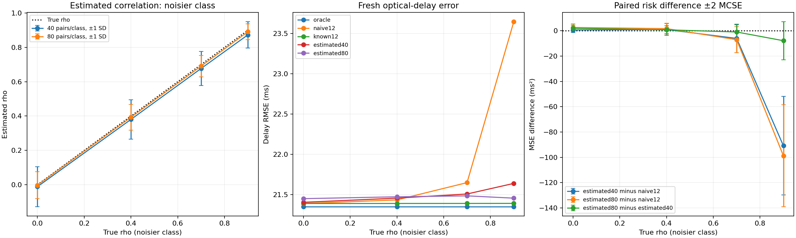

# Estimating repeat correlation for optical camera timing

A **45–60 minute integrated lab** about the cost of learning a noise model. Follow a diffraction spot through a camera, subpixel localization and affine clock calibration. Then spend a fixed acquisition budget on estimating temporal correlation and test whether the resulting delay measurements improve.

## Objectives and prerequisites

Learn to eliminate unknown characterization means, derive a profile restricted likelihood (REML) for temporal correlation, distinguish known from estimated covariance corrections, and evaluate acquisition allocations on fresh optical-delay measurements. Prerequisites: Gaussian covariance, least squares, matrix determinants, elementary Fourier optics and Python. The [previous lab](https://github.com/ahmetalpkilic/correlated-repeat-optical-timing-learning-lab) assumed correlation known; this standalone lesson pays for estimating it.

```sh
git clone https://github.com/ahmetalpkilic/estimated-repeat-correlation-learning-lab.git
cd estimated-repeat-correlation-learning-lab
sh run_demo.sh
```

Python 3.9–3.12 and a POSIX shell. The runner creates `.venv`, installs pinned dependencies, runs tests and writes `outputs/results.json` and `outputs/experiment.png`. Initial installation needs internet; `.venv/bin/python lab.py` subsequently runs offline. All inputs are synthetic. Fixed seeds reproduce the committed `examples/` outputs in the tested environment; other platforms may differ in final digits.

Suggested session: optics and camera 10 min, REML derivation 15 min, experiment and code 15 min, validation and one exercise 10–20 min.

| Area | Explicit model | Connection |
|---|---|---|
| Optics | Fourier transform of a 550 nm Gaussian pupil | Defines the spot width |
| Camera | 16 mm focal length, 4 µm integrated pixels, Gaussian read noise | Produces localization observations |
| Vision / metrology | Subpixel spot location, known motion, affine clocks | Recovers camera exposure delay |
| Mathematics | Matrix-normal REML, AR(1), GLS, paired Monte Carlo risk | Propagates learned noise-model uncertainty into delay error |

## Optical and camera model

The pupil amplitude is `exp(-(rho_x²+rho_y²)/a²)`, with amplitude radius `a=1000 µm`, wavelength `lambda=0.550 µm`, and focal length `f=16000 µm`. This is an **untruncated Gaussian pupil**, not a uniform circular aperture or an f-number model. Scalar paraxial monochromatic Fourier optics, an aberration-free isolated point and instantaneous exposure are assumed.

The Fourier amplitude is proportional to `exp(-(pi*a*x/(lambda*f))²)`. Squaring gives intensity SD `lambda*f/(2*pi*a)`. At pixel pitch `p=4 µm`,

```text
sigma_px = lambda*f/(2*pi*a*p) = 0.350140875 px
mu_j(u) = B + F [Phi((j+0.5-u)/sigma) - Phi((j-0.5-u)/sigma)]
```

`Phi` is the standard-normal CDF; `F=10000 ADU`, `B=20 ADU`. The camera has square pixels, no distortion/skew, principal point `(0,0)` and `K=diag(4000,4000,1)` in pixels. We simulate the horizontal marginal of a separable 2-D PSF. Signed ROI pixel centers are `j=-16,...,+16`, increasing to the right; each integrates `[j-0.5,j+0.5]`. These are not top-left array coordinates.

Each marginal sample receives independent Gaussian read noise of SD 2 ADU. There is no shot noise, saturation, quantization, or photometry fitting; flux, background and optical width are known. Least squares fits `u` using the analytic pixel-integral derivative. This high-SNR toy model isolates clock uncertainty, not a full camera noise budget.

The independently known image trajectory is `u(r)=u0+v*r`, `u0=0.23 px`, `v=0.8 px/reference second`. Clocks obey `r=alpha*t+beta`: true `alpha=1.002 reference s/master s`, `beta=0.030 reference s`. A frame tagged `T=2.0 master s` was exposed at `T+delta`, with true delay `delta=0.040 master s`.

## Acquisition model and a fixed budget

There are 40 event means `(tau_i, alpha*tau_i+beta)`, with latent master times evenly spaced in `[-1,+1] s`. Estimators never receive these true means. Even events have clock SDs `(0.030,0.020) s` and within-pair correlation .5; odd events have SDs `(0.120,0.040) s` and within-pair correlation .3. Denote these two marginal 2×2 covariances by C_g [s²]. Known event quality labels `g=i mod 2` permit pooling within each class.

Each calibration block repeats one unknown event mean m times. This is idealized replay, not advancing synchronization times. Correlation across equally spaced repeats is `R_kl=rho_g^|k-l|`. Noise is Gaussian and separable: `Cov(e_k,e_l)=R_kl C_g`. The even class has true rho=0; the odd class sweeps 0, .4, .7 and .9. Each block starts stationary and independently. The repeat interval is an acquisition index; no physical time scale is inferred.

Two additional stationary characterization sequences, one per quality class, each supply n timestamp pairs at an unknown constant mean. They share the respective class correlation and covariance with the calibration blocks, but are statistically independent of them. **Both class correlations are estimated**, including the truly iid class. The characterization fit receives only its sequence, not true means, C, rho, calibration samples or evaluation errors.

| Policy | Characterization pairs | Calibration pairs | Total | Meaning |
|---|---:|---:|---:|---|
| naive12 | 0 | 40×12 = 480 | 480 | Treat repeats as independent |
| estimated40 | 2×40 = 80 | 40×10 = 400 | 480 | Estimate each rho from 40 pairs |
| estimated80 | 2×80 = 160 | 40×8 = 320 | 480 | Estimate each rho from 80 pairs |
| known12 | 0 | 480 | 480 | Infeasible free-rho reference |
| known40 / known80 | 80 / 160, discarded | 400 / 320 | 480 | Matched controls supplied true rho |
| oracle | No calibration needed | No calibration needed | — | Exact C, unattainable reference |

Matched known controls isolate correlation-estimation error at the same remaining repeat budget. known12 versus matched controls isolates lost covariance-calibration samples. Neither known controls nor oracle are feasible budget competitors. The experiment evaluates two predetermined allocations; it does not optimize allocation using the final test errors. Pair count is the cost unit; reset/settling time and per-sample cost differences are excluded.

Characterization nuisance covariance is profiled out and discarded. The experiment intentionally reserves those sequences solely for rho estimation; joint reuse for covariance might improve performance and is outside this two-stage design.

## Derive correlation estimation from mean-free data

For one characterization sequence `Z` of shape n×p with p=2:

```text
Z ~ matrix normal(1 mu^T, R(rho), C)
W = R^-1
Q = W - W1 (1^T W1)^-1 1^T W
A(rho) = Z^T Q Z
```

Q removes the unknown constant two-clock mean. To derive a restricted likelihood, choose any `(n-1)×n` orthonormal contrast matrix D with `D1=0`. Then `Y=DZ` has row covariance `V=DRD^T`, no unknown mean, and column covariance C. Minus twice its Gaussian log likelihood, omitting constants, is

```text
p log|V| + (n-1) log|C| + tr(C^-1 Y^T V^-1 Y).
```

Differentiating with respect to C gives `C_hat=A/(n-1)`; substitution makes the trace term `(n-1)p`, constant in rho. Using `D^T V^-1 D=Q` and `|V|=|R|(1^T W1)/n`, minimize

```text
J(rho) = p log|R| + p log(1^T W1) + (n-1) log|A/(n-1)|.
```

The omitted `-p log n` has no effect on the minimum. This is a profile **restricted** likelihood, not the ordinary likelihood with n degrees of freedom, and it does not guarantee an unbiased rho estimate at finite n.

For stationary AR(1), `|R|=(1-rho²)^(n-1)`. Its inverse is tridiagonal with end diagonal 1, interior diagonal `1+rho²`, and off-diagonal `-rho`, all divided by `1-rho²`. `reml_score` uses this identity in O(n) operations. No dense inverse is required. Subtracting the ordinary column mean first improves numerical stability because Q annihilates every constant.

```python
# The sequence is the only input: no true noise parameters enter this fit.
rho_hat = fit_rho(characterization)
# Select bounded minima of J on [-.95,.95]; keep and count boundary fits.
# Profile nuisance C is not used downstream in this experiment.
```

The code evaluates 39 grid points and refines all bracketed local minima, also considering endpoints. This is a reproducible numerical procedure, not a global-optimum proof for arbitrary data. The interval `[-.95,.95]` is an estimator assumption, not a confidence interval. Negative estimates remain allowed even when true rho=0. Boundary frequencies are reported so clipping cannot silently masquerade as exact recovery.

## Plug learned correlation into covariance calibration

For each separate m-repeat event block, compute

```text
C_hat_i = Z_i^T Q_m(rho_hat_g) Z_i/(m-1),
```

then average C_hat_i across the 20 events in its known quality class. With true rho, `tr(QR)=m-1` and this scatter is unbiased for C. Conditional on an independently estimated rho_hat,

```text
E[C_hat_i | rho_hat] = tr(Q_m(rho_hat) R_m(rho_true))/(m-1) * C_g.
```

Thus independence prevents data reuse but **does not remove plug-in bias**: a nonlinear estimated whitening matrix need not have the correct trace on average. Shared rho_hat induces dependent covariance errors across class events. The full outer simulation redraws characterization and calibration together to propagate this effect.

The naive estimator uses ordinary centered scatter `Z^T HZ/(m-1)`, `H=I-11^T/m`. Its expectation is `b C` with `b=[m-(1^T R1)/m]/(m-1)`. At rho=.9 and m=12, b≈.3421. Class-dependent errors change clock-fit weights. A common scalar multiplying all C would cancel and hide this failure.

## From calibration weights to optical delay

Treat `S_i` as a plug-in covariance, temporarily fixed during each fit. With latent true time `tau_i`, minimize

```text
Q = sum_i [z_i-(tau_i,alpha*tau_i+beta)]^T S_i^-1
          [z_i-(tau_i,alpha*tau_i+beta)]
```

For `d=(1,alpha)`, differentiation gives

```text
tau_i* = d^T S_i^-1 (x_i,y_i-beta) / (d^T S_i^-1 d).
V_i(alpha) = alpha²*S_i,xx - 2*alpha*S_i,xy + S_i,yy
Q_profile = sum_i (y_i-alpha*x_i-beta)²/V_i(alpha)
beta*(alpha) = sum_i [(y_i-alpha*x_i)/V_i] / sum_i [1/V_i].
```

Search numerically over `alpha in [0.5,1.5]`. The implementation checks a 65-point grid, refines bracketed minima and rejects boundary/flat fits. This is not a global-optimum guarantee for arbitrary data. Independent full latent-event optimization validates the implemented objective. There is no `log V_i` term: this profiles fixed latent times; it does not marginalize random times. With estimated covariance, this is a **plug-in procedure**, not the full likelihood jointly accounting for covariance uncertainty. We make no confidence-interval or coverage claim.

Finally,

```text
r_hat = (u_hat-u0)/v
 delta_hat = (r_hat-beta_hat)/alpha_hat - T
 d(delta) ≈ du/(v*alpha) - d(beta)/alpha - (T+delta)*d(alpha)/alpha.
```

Thus precise optical localization can coexist with poor delay precision when calibration weights are uncertain and rate errors are extrapolated.

## Controlled experiment and validation

For each true odd-class rho, 300 independent outer trials redraw characterization sequences, repeat blocks, 40 fresh independent synchronization timestamp pairs and one fresh noisy camera image. Four separate seeded streams keep these roles independent. Methods share observations within trials; larger budgets use prefixes of the same sequences/blocks. Rho levels also share base normal draws, so they are not independent experiments.

Final timestamps are neither repeat averages nor samples reused from characterization. Each uses marginal C and is independent across events. Every policy fits the clock and converts the same subpixel image location to delay. A failed numerical fit raises instead of silently dropping trials. `failed_fits=0` appears only on completion.

The report gives rho bias/SD/boundary frequency, delay bias/SD/RMSE and paired squared-error differences `D=e_A²-e_B²`. `MCSE=SD(D)/sqrt(300)` measures simulation uncertainty. Plot risk bars are ±2 MCSE, not hardware confidence intervals. The rho plot instead shows ±1 sampling SD across trials. Inspect these uncertainties before declaring an allocation better.

Read `optics.py` for pixel-integrated image formation, `clock_model.py` for the inverse timing model, `repeat_model.py` for covariance correction, and `lab.py` for the new REML characterization and budget experiment. Sixteen tests validate independent pupil FFT and quadrature, analytic localization derivative, full latent-event clock optimization and generalized-eigenvalue special cases, AR stationarity and lag covariance, REML against orthonormal error contrasts, dense-grid agreement, mean/clock-unit invariance, long-sequence recovery, independent whitened GLS, misspecified-whitening trace expectation, budget arithmetic, invalid inputs and fresh-seed end-to-end execution. Tests do not require a chosen allocation to win on one random sample.

## Expected results

| True odd-class rho | Naive 12 | Estimated 40/class | Estimated 80/class | Known rho, 12 repeats |
|---:|---:|---:|---:|---:|
| 0.0 | 21.392 | 21.406 | 21.452 | 21.392 |
| 0.4 | 21.436 | 21.458 | 21.475 | 21.392 |
| 0.7 | 21.650 | 21.509 | 21.486 | 21.392 |
| 0.9 | 23.647 | 21.641 | 21.458 | 21.393 |

Delay RMSE in ms, 300 trials per level. At rho=.9, 80 characterization pairs per class give estimated rho mean .8912 and SD .0454, versus .8729 and .0771 for 40/class. **Upper-bound fits occur in 23.0% and 29.3% of these trials**, respectively: this is a bounded estimator whose apparent performance partly depends on that bound. No boundary fits occur in the other simulated levels.

At rho=.9, estimated80 minus naive12 MSE is **-98.74 ± 40.24 ms²** (two MCSE). Estimated80 minus estimated40 is **-7.89 ± 15.05 ms²**: this run does not establish that the larger characterization allocation is better. At rho=0, characterization adds estimation uncertainty and reduces the repeat budget without a correlation bias to fix. Inspect all matched known-rho comparisons in the JSON; tiny differences do not justify claims of superiority.

Optical-center SD is .0002765 px, versus PSF SD .3501409 px. Subpixel localization precision is not optical resolution. All numerical fits succeeded; retained boundary rho fits are explicitly counted, not treated as solver failures.




## Exercises

1. Derive `E[C_hat | rho_hat]` from the trace identity. Use independent draws to compare predicted and empirical variance scale at a deliberately wrong rho.
2. Add n=20, m=11 (still 480 pairs). Compare rho dispersion and paired delay risk; explain why more calibration repeats may not compensate for uncertain whitening.
3. Vary the search interval to [-.99,.99]. Record boundary frequency and downstream risk near true rho=.95; do not interpret a boundary fit as a confidence bound.
4. Introduce a different rho in characterization and calibration. Explain why more characterization can increase confidence in a wrong transferable model.
5. Double wavelength or pixel pitch consistently in image generation and fitting. Derive the changed PSF width and compare localization uncertainty with the calibration contribution to delay.

## Limitations and next lesson

Gaussian stationary separable AR(1), correctly known quality classes and identical correlation in characterization/calibration are strong assumptions. Independent resets are free and pair counts proxy cost. Rho is bounded and estimated with finite-sample error; neither unbiasedness nor interval coverage is claimed. The two-stage design discards characterization covariance information and need not be optimal. Exposure is instantaneous; optics, photometry, trajectory and pixel geometry are known. Shot noise, drift, saturation, model mismatch and hardware systematic error are absent. Results quantify **synthetic repeatability, not instrument accuracy or traceable calibration**.

Next focused lesson: characterize transfer failure when repeat correlation changes between characterization and calibration; compare fixed-cost refresh policies on fresh optical-delay data. This should test nonstationarity, rather than repeat the same stationary allocation sweep.

## Attribution and reviewed sources

New REML estimator, budget experiment, nine tests and documentation: MIT, copyright 2026 ahmetalpkilic. Optical/clock helpers, repeat helpers and seven optical/clock tests were reused from [correlated-repeat-optical-timing-learning-lab at 5a034d30](https://github.com/ahmetalpkilic/correlated-repeat-optical-timing-learning-lab/tree/5a034d304039ae1a01a23f956929dc3c71b2e7af); its MIT notice and inherited notices are retained in `licenses/`.

Reviewed current public [prysm](https://github.com/brandondube/prysm) for Fourier-optics context, [SciPy](https://github.com/scipy/scipy) for optimization and linear algebra, NumPy and Matplotlib for arrays/plots, plus the predecessor. `sources.json` records exact commits, dates, recent commit subjects, public/archive status and pinned license links. Full license snapshots preserve prysm MIT, NumPy/SciPy BSD-3-Clause and Matplotlib's permissive agreement. Prysm is context only. Reviewed development heads are distinct from pinned runtime releases; no development code was copied or executed. Runtime distribution third-party notices remain applicable. The REML derivation here is supplied explicitly and independently checked, not attributed to an upstream implementation.
